<p align="center">
  <a href="https://github.com/Roxsmb/tailref/releases/latest">
    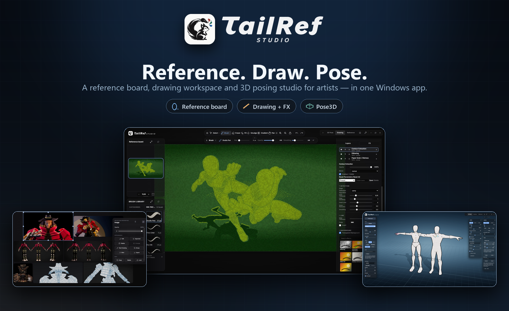
  </a>
</p>

<p align="center">
  <a href="https://github.com/Roxsmb/tailref/releases/latest"></a>
  <a href="https://github.com/Roxsmb/tailref/releases/latest"></a>
  <a href="LICENSE"></a>
  <a href="https://www.buymeacoffee.com/roxsmb"></a>
</p>

<h1 align="center">TailRef Studio</h1>

<p align="center">
  <strong>Collect references. Draw over them. Pose them in 3D.</strong><br>
  Free for Windows 10/11 x64 · no account, no cloud, no telemetry.
</p>

<p align="center">
  <a href="#feature-showcase">Features</a> ·
  <a href="#screenshots">Screenshots</a> ·
  <a href="#installation">Installation</a> ·
  <a href="#support-tailref">Support</a> ·
  <a href="#faq">FAQ</a> ·
  <a href="#roadmap">Roadmap</a> ·
  <a href="#license">License</a>
</p>

---

## What is TailRef?

TailRef is a desktop workspace for artists who work from references. Instead of
juggling an image viewer, a moodboard, a drawing app and a posing tool, you keep
the whole loop in one window:

1. **Collect** images on an infinite reference board — drag, paste, import, or
   send them from the built-in ArtStation and Pinterest panels.
2. **Draw** over them with a pressure-sensitive ink engine, layers, masks and a
   brush library that imports and exports Photoshop `.abr` files.
3. **Pose** a 3D mannequin or your own FBX/GLTF/OBJ models, set the camera and
   lighting, then capture the shot straight to the board.
4. **Finish** with a non-destructive FX stack, and export the result as PNG,
   JPEG, WebP, AVIF, BMP, ICO or PDF.

It runs offline. There are no accounts, no cloud, no telemetry, and your
projects stay on your machine.

> **License in one line:** free for personal, educational, research, hobby and
> other noncommercial use. TailRef is **source-available**, not unrestricted
> open-source software. Commercial use requires written permission.
> See [License](#license).

<p align="center">
  <sub>TailRef is free to use. If it saves you time, you can <a href="https://www.buymeacoffee.com/roxsmb"><strong>☕ buy me a coffee</strong></a> to support development.</sub>
</p>

## Why artists keep it open

| Benefit | Why it matters |
|---|---|
| **🔎 Your references stay in the project** | No more alt-tabbing to a browser or a folder. The images, the notes and the drawing live on the same board. |
| **✏️ You can draw on the reference** | Trace, paint over, annotate and correct — directly on the image, in layers, without exporting to another app. |
| **🧍 Pose before you commit** | Block a pose, check anatomy and lighting from any angle, then capture it as a new reference on the board. |
| **🎨 It looks the way you want** | Ten built-in themes, custom palettes, interface skins and ten UI languages. |
| **🔒 It stays yours** | Offline by default, no account, no cloud, no telemetry. Projects are plain files on your disk. |

## Before and after TailRef

| The usual workflow | With TailRef |
|---|---|
| References scattered across folders, browser tabs and Pinterest boards | One infinite board per project, with search, groups, locking and notes |
| Switch to a drawing app to sketch over a reference | Draw over it in place, with layers, masks and `.abr` brushes |
| Open a full DCC just to check a pose | Pose a mannequin in Pose3D and capture it to the board in seconds |
| Rebuild the same look with a stack of filters | A non-destructive FX stack with presets and before/after preview |
| Lose work to a crash or a stray overwrite | Automatic backups, crash recovery, trash and atomic project files |

## Feature showcase

Six short clips, recorded from TailRef 1.4.1 and sped up. Every frame is the
real application — no mockups, no stock footage.

### 01 — Collect references without leaving the app

Browse ArtStation or Pinterest in a sandboxed panel and send images to the board
in one click. Then arrange, crop, group, lock and annotate them on an infinite,
pannable canvas. The research and the drawing live in the same project.

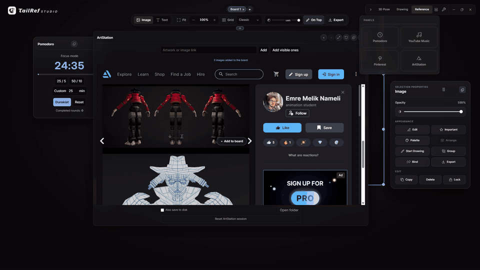

### 02 — Pose a mannequin for anatomy and light

Use the built-in two-figure mannequin or load FBX, GLTF/GLB and OBJ models. Pose
bones with IK and gizmos, orbit with Maya or Blender navigation, then set the
camera, lighting rig and HDR environment. Capture beauty, alpha, depth, normal
and wireframe passes up to 8K and send them straight to the reference board.

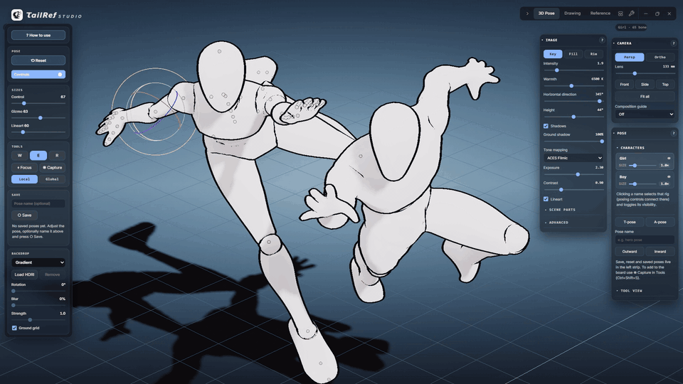

### 03 — Capture it, then draw over it

Pick a pass — beauty, alpha, depth, normal or wireframe — at up to 8K, and send
it straight to the board. The shot arrives as a reference item and on the
canvas, so you can switch from Pose3D to Drawing and start working on top of it
without saving, importing or leaving the app.

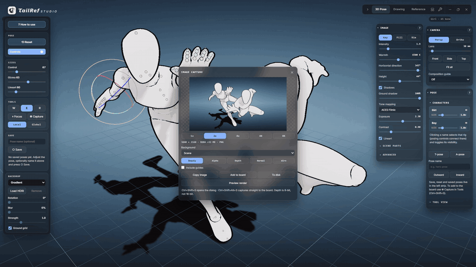

### 04 — Grade and arrange a whole set at once

Select any number of references and edit them together in the Image Editor:
saturation, brightness, contrast, warmth and opacity, rotate 90° left or right,
flip horizontally or vertically, and crop with free, 1:1, 16:9 and other
presets. Palette extraction pulls the colours out of each image.

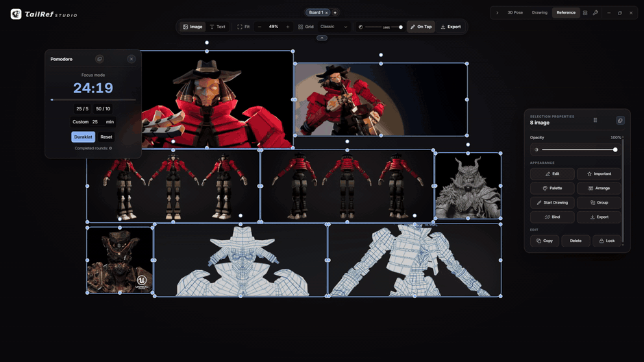

### 05 — Finish with a non-destructive FX stack

Stack oil paint, glitch, dithering, contour extraction, paper grain, halftone and
more on any layer. Reorder effects, tune their parameters, save presets and
compare before and after — all without touching the original pixels.

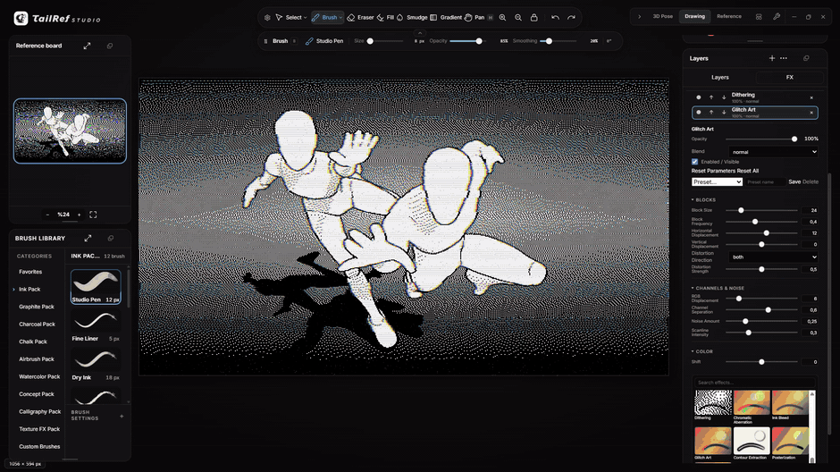

### 06 — Make the workspace yours

Choose from ten built-in themes, build a custom palette, change panel opacity,
interface density and UI scale, or load a complete interface skin. The interface
is available in ten languages, with a searchable settings hub and a central
keymap.

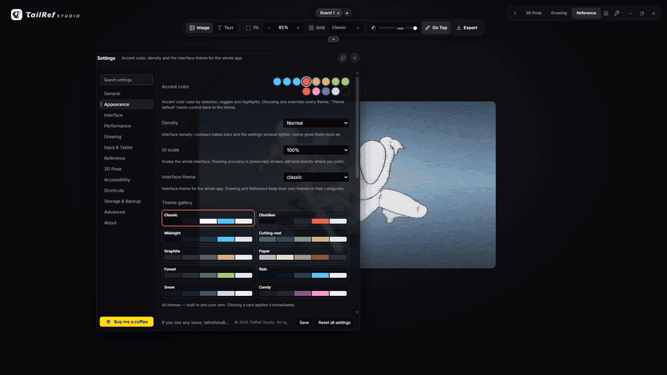

### And the rest

| Area | What you get |
|---|---|
| **Reference board** | Infinite canvas, drag-and-drop, paste and multi-file import, move/scale/rotate/crop, grid and stack layouts, groups, locking, z-order, text notes, link items, trash with restore, image inspector, palette extraction. |
| **Drawing** | Brush, pencil, eraser, paint bucket, gradient, smudge and liquify; shapes, text, eyedropper; rectangular and lasso selection; pressure and tilt, stabilizer, spacing and hardness; symmetry, shape snapping and a radial tool menu. |
| **Layers & FX** | Layers with masks, blend modes and groups; region-aware undo/redo; a post-processing FX stack with presets and before/after preview; tile-based canvas with Web Worker and optional GL dab processing. |
| **Brush library** | Built-in and custom brushes, procedural or PNG-tipped; categories, favorites, search and per-brush settings; Photoshop `.abr` import and export, including RLE and 16-bit tip data. |
| **Projects** | Automatic mode with IndexedDB and rotating JSON backups, or manual atomic `.tail` files; project browser, crash recovery, backups and trash. |
| **Panels** | Pinterest, ArtStation and YouTube Music panels; dock them or detach into an always-on-top window; guest sites run in restricted, sandboxed sessions. |
| **Interface** | Light and dark themes, custom palettes, interface skins, validated UI packages, floating and dockable panels, compact modes, searchable settings, shortcut overlay, 10 UI languages. |

## Works with

| Format | What is supported |
|---|---|
| **Export** | PNG, JPEG, WebP, AVIF, BMP, ICO, PDF |
| **3D models** | FBX, GLTF/GLB, OBJ, HDR environments |
| **Brushes** | Photoshop `.abr` import and export |
| **Projects** | `.tail` project files, automatic backups, crash recovery |

## Screenshots

Every image below is captured from TailRef 1.4.1 itself. The
[`docs/screenshots/`](docs/screenshots/) folder holds the clean capture set and
the rules used to take it.

<p align="center">
  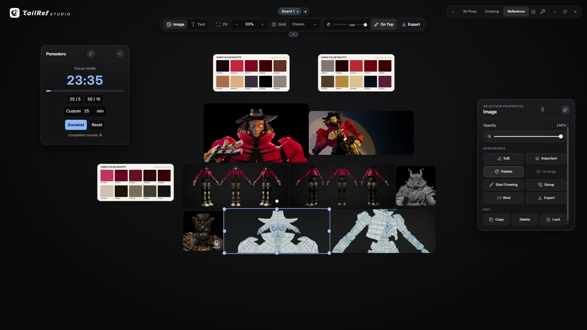
  &nbsp;
  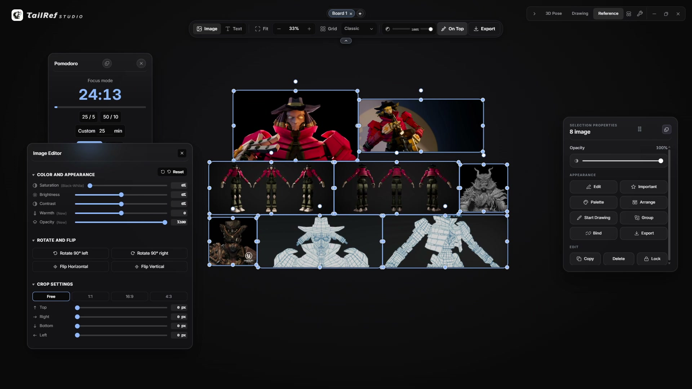
</p>
<p align="center">
  <sub><b>Reference board</b> — collect, arrange, annotate and pull palettes. &nbsp;·&nbsp; <b>Image Editor</b> — grade, rotate, flip and crop a whole selection.</sub>
</p>

<p align="center">
  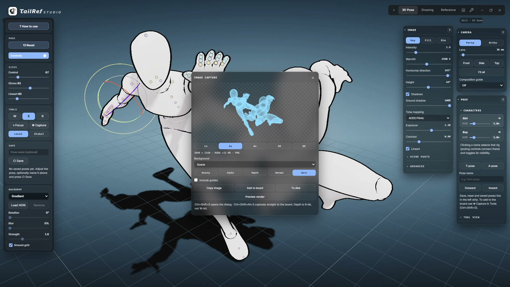
  &nbsp;
  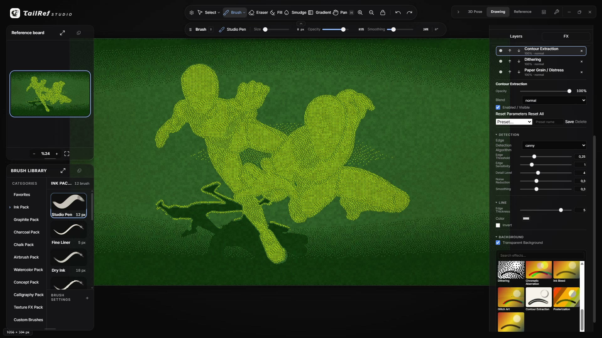
</p>
<p align="center">
  <sub><b>Pose3D capture</b> — beauty, alpha, depth, normal and wireframe passes. &nbsp;·&nbsp; <b>Drawing + FX</b> — a non-destructive stack on any layer.</sub>
</p>

<p align="center">
  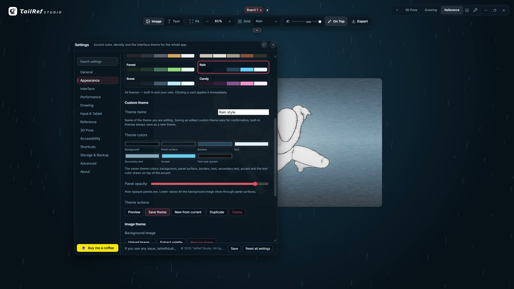
  &nbsp;
  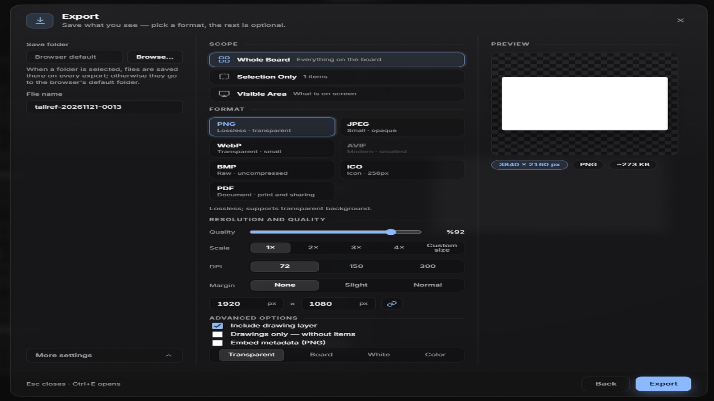
</p>
<p align="center">
  <sub><b>Appearance</b> — themes, custom palettes and panel opacity. &nbsp;·&nbsp; <b>Export</b> — format, scale, DPI, margins and transparency.</sub>
</p>

## Who is TailRef for?

- **Concept and character artists** who collect references and sketch over them
  in the same session.
- **3D artists** who need fast pose, anatomy and lighting reference without
  opening a full DCC.
- **Illustrators** who want a drawing surface next to their visual research.
- **Animators and game developers** building moodboards, pose sheets and
  turnaround references.
- **Students** practising anatomy, gesture and lighting from a controllable
  mannequin.

## Installation

### Download

Get the latest build from the
[**Releases page**](https://github.com/Roxsmb/tailref/releases/latest).

| File | What it is |
|---|---|
| `TailRef_Studio.exe` | Portable build. Run it from any folder; no installation or admin rights. |
| `TailRef_Studio_Setup.exe` | Windows installer with optional desktop and Start Menu shortcuts. |
| `SHA256SUMS.txt` | SHA-256 checksums for both executables. |

Only download TailRef from this repository's Releases page. Builds from other
sources are unofficial and may be modified.

### Run it

1. Download the portable executable or the installer.
2. For the portable build, put it anywhere you control and run it.
3. For the installer, run the wizard and choose an install directory.

Uninstalling does not delete your projects.

### Requirements

- Windows 10 or 11, 64-bit.
- A GPU and driver that support the Chromium version bundled with Electron 45.
- No internet connection required. The Pinterest, ArtStation and YouTube Music
  panels need internet only when you open them.

### SmartScreen and checksums

Builds are **not code-signed**. Windows SmartScreen may warn about an unknown
publisher. This is expected for unsigned independent builds.

Verify a download before running it:

```powershell
Get-FileHash .\TailRef_Studio.exe -Algorithm SHA256
```

Compare the result with `SHA256SUMS.txt` on the release page. If the values
differ, do not run the file.

### Where your data lives

| Data | Location |
|---|---|
| Settings, projects, brushes | `%APPDATA%\TailRef\` |
| Automatic backups | `%APPDATA%\TailRef\Backups\` |
| Known-good backup copy | `%APPDATA%\TailRef\Backups\good\` |
| Manual project files | wherever you save `.tail` files |

Copying the `.exe` does not copy your work. Full details, including
troubleshooting, are in [`docs/INSTALLATION.md`](docs/INSTALLATION.md).

## Support TailRef

<p align="center">
  <a href="https://www.buymeacoffee.com/roxsmb">
    
  </a>
</p>

TailRef is a one-person project, built and maintained by an independent artist.
It is free for noncommercial use and has no ads, no tracking and no paid tier.

If TailRef helps your work, you can
[**buy me a coffee**](https://www.buymeacoffee.com/roxsmb). Support goes towards
development time, new features and keeping the project alive.

Other ways to help that cost nothing:

- ⭐ **Star this repository** — it helps other artists find TailRef.
- 🐛 **Report bugs** with clear reproduction steps.
- 💡 **Request features** or share your workflow in the issues.
- 🎨 **Show your work** made with TailRef.

## TailRef vs. a dedicated reference board (PureRef)

TailRef is often compared to [PureRef](https://www.pureref.com/), the well-known
reference-board app. Both let you pin images to an infinite canvas, and TailRef
is **not affiliated with PureRef** — but they are built for different scopes.

If all you need is a lightweight pinboard, a dedicated reference board does that
job well. TailRef is for the case where the reference, the drawing and the pose
belong to the same project:

| | A reference board only | TailRef |
|---|---|---|
| Collect and arrange references | Yes | Yes — plus groups, notes, links and palette extraction |
| Draw on top of references | No | Ink engine, layers, masks, selection and `.abr` brushes |
| 3D pose and lighting reference | No | Pose3D mannequin, FBX/GLTF/OBJ import, 8K captures |
| Finish without leaving the app | No | Non-destructive FX stack and PDF/image export |
| Platforms | Windows, macOS, Linux | Windows 10/11 x64 |

In short: choose a dedicated reference board for a pure pinboard, and TailRef
when you want the reference board, the drawing workspace and the 3D posing
studio to share one project and one file.

## FAQ

### What is TailRef?

A Windows desktop app for collecting reference images, drawing over them and
posing a 3D mannequin. It combines a reference board, an ink engine, a brush
library and a 3D posing module in one project.

### Is TailRef free?

Yes, for noncommercial use. TailRef is distributed under the
**PolyForm Noncommercial License 1.0.0**, which covers personal, educational,
research, hobby and other noncommercial purposes. Selling TailRef, charging for
access, paid redistribution, commercial integration and other commercial
exploitation require prior written permission from the copyright holder.

### Is TailRef open source?

No. TailRef is **source-available**: the source is public so it can be studied,
audited, improved and shared for noncommercial purposes, but the license does
not grant the same rights as an OSI-approved open-source license. See
[`LICENSE-FAQ.md`](LICENSE-FAQ.md).

### Does TailRef work on macOS or Linux?

No. TailRef targets Windows 10/11 x64. macOS, Linux and ARM64 Windows builds are
not planned.

### Does TailRef need an internet connection?

No. The app, your projects and the drawing tools work offline. The Pinterest,
ArtStation and YouTube Music panels need internet only when you open them.

### Is TailRef a PureRef alternative?

It can be, but it is broader. TailRef covers the reference-board workflow and
adds drawing, a brush library, an FX stack and Pose3D. It is an independent
project and is not affiliated with PureRef or any other product. See
[TailRef vs. a dedicated reference board](#tailref-vs-a-dedicated-reference-board-pureref).

### Can I use TailRef for commercial work?

Commercial use of the software requires written permission. The artwork you
create with TailRef is yours; the license covers the software, not your output.
If you are unsure whether your use is commercial, ask first — see
[`LICENSE-FAQ.md`](LICENSE-FAQ.md).

### Where should I download TailRef?

Only from the
[**official Releases page**](https://github.com/Roxsmb/tailref/releases/latest).
Verify the SHA-256 checksum before running a build.

### How do I report a bug or request a feature?

Open an issue using the bug report or feature request template. Include your
TailRef version, Windows version and clear reproduction steps. Do not attach
private artwork or project files unless they are required to reproduce the
problem. Security issues should be reported privately — see
[`SECURITY.md`](SECURITY.md).

### Can I contribute?

Yes. Read [`CONTRIBUTING.md`](CONTRIBUTING.md) and the
[Code of Conduct](CODE_OF_CONDUCT.md) first. Contributors keep copyright in
their work. Contributions that require relicensing for commercial purposes need
a reviewed [CLA](docs/CLA.md); until then they are not merged.

## Roadmap

TailRef 1.4.1 is the current release. The near-term work is:

- ink-engine polish and the remaining parity items tracked in
  [`docs/INK_STATUS.md`](docs/INK_STATUS.md);
- the magic-wand selection tool, currently a known gap;
- better mapping and reporting for Photoshop `.abr` brush dynamics;
- keeping the public documentation and captures current;
- closing the remaining localization gaps.

Under consideration: code signing, an installer update path, enabling the native
ink kernel by default, more Pose3D capture passes, and community themes and UI
packages. Not planned: macOS/Linux builds, cloud sync, accounts, telemetry, a
plugin marketplace, mobile/web builds, paid tiers or ads.

The full list, with the difference between next, considering and not planned, is
in [`docs/ROADMAP.md`](docs/ROADMAP.md).

## Development

Requirements: **Node.js 20 LTS** (18+ works) and npm. Packaging targets Windows.

```bash
git clone https://github.com/Roxsmb/tailref.git
cd tailref
npm install
npm start
```

`npm start` regenerates the renderer bundle and launches Electron. The generated
`src/renderer/app.js` is built from `src/renderer/core/*.js`; never edit it by
hand.

```bash
npm run gates        # fast chain: 14 pure gates
npm run gates:full   # full chain: 69 gates (Electron + CDP, slow)
npm run build:portable
npm run build:setup
npm run test:package # verifies app.asar against the working tree
```

More: [`docs/DEVELOPMENT.md`](docs/DEVELOPMENT.md) and
[`docs/ARCHITECTURE.md`](docs/ARCHITECTURE.md).

### Technology

- **Electron 45** — desktop shell.
- **Plain JavaScript** — no framework, no bundler, no runtime npm dependencies.
- **Canvas2D + WebGL** — custom ink engine, with Web Workers for region work.
- **three.js r170** (vendored, MIT) — the 3D module.
- **fflate 0.8.2** (vendored, MIT) — compression for `.tail` files and `.abr`.
- **Optional C++ N-API kernel** — the app falls back to JavaScript when it is not
  built.
- **IndexedDB + localStorage + `.tail` files** — persistence.

Third-party components and licenses:
[`THIRD_PARTY_NOTICES.md`](THIRD_PARTY_NOTICES.md).

## Contributing and security

Contributions are welcome. Start with [`CONTRIBUTING.md`](CONTRIBUTING.md) and
follow the [Code of Conduct](CODE_OF_CONDUCT.md).

- **Bugs and feature requests:** use the issue templates.
- **Security issues:** report privately — see [`SECURITY.md`](SECURITY.md).
- **Licensing:** contributors keep copyright in their work. Contributions that
  require relicensing for commercial purposes need a reviewed
  [CLA](docs/CLA.md); until then they are not merged.

## License

TailRef is distributed under the **PolyForm Noncommercial License 1.0.0**. The
complete, unmodified license text is in [`LICENSE`](LICENSE) and at
<https://polyformproject.org/licenses/noncommercial/1.0.0>.

### Permitted, subject to the license

- Personal use.
- Educational use.
- Research.
- Hobby projects.
- Noncommercial modification.
- Noncommercial redistribution.

### Not permitted without separate written permission

- Selling TailRef or modified versions.
- Charging for access.
- Paid redistribution.
- Commercial integration.
- Offering TailRef as a paid service.
- Other commercial exploitation covered by the license.

Commercial exceptions may only be granted through explicit written permission
from the copyright holder, **Emre Melik Nameli**.

TailRef is **not unrestricted open-source software**. It is free and
source-available: the source is public so it can be studied, audited, improved
and shared for noncommercial purposes. Practical questions are answered in
[`LICENSE-FAQ.md`](LICENSE-FAQ.md); that FAQ summarizes the policy and does not
override the license.

## Credits

**TailRef** is designed and developed by **Emre Melik Nameli**.

```
Copyright © Emre Melik Nameli
```

TailRef Studio is the project's publishing name. It is a brand, not a separate
company or legal entity. See [`NOTICE`](NOTICE).

Third-party libraries, fonts and assets remain the property of their respective
authors and are listed in [`THIRD_PARTY_NOTICES.md`](THIRD_PARTY_NOTICES.md).
The TailRef name, wordmark and logo are covered by [`TRADEMARK.md`](TRADEMARK.md).

## Contact

- **Email:** tailrefstudio@gmail.com
- **Issues:** [github.com/Roxsmb/tailref/issues](https://github.com/Roxsmb/tailref/issues)
- **Support:** [buymeacoffee.com/roxsmb](https://www.buymeacoffee.com/roxsmb)
- **Documentation:** [`docs/`](docs/README.md)
